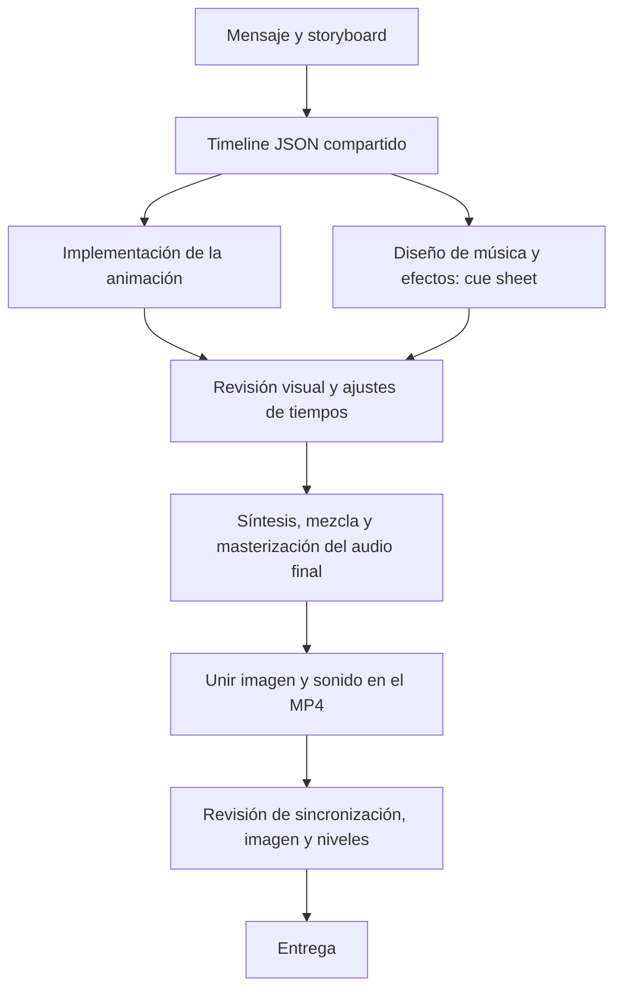

# Cómo genero la música y los efectos de sonido

En estos videos uso el motor `sfx` del proyecto para sintetizar sonidos por código. No usé grabaciones, bibliotecas de audio de stock ni un servicio externo de generación musical.

**El sonido se planifica con el storyboard y el timeline. La mezcla final se genera después de revisar y ajustar la animación.** Puedo generar una prueba antes para evaluar el ritmo, pero verifico siempre el audio del MP4 terminado.

## En qué parte del flujo ocurre



1. **Storyboard:** decido qué sucede y qué sensación debe acompañarlo. Por ejemplo: crecimiento del tráfico, tensión por saturación y recuperación. Identifico los eventos que necesitan sonido; no sonorizo cada partícula.
2. **Timeline JSON:** fijo los tiempos de escenas, acciones, música y transiciones. Este archivo sincroniza imagen y sonido.
3. **Animación y diseño sonoro:** implemento las escenas y preparo un archivo Python con la partitura de eventos, llamado *cue sheet*. Elijo instrumentos, notas, efectos, duración, volumen y posición estéreo.
4. **Revisión visual:** ajusto la cámara, los textos y el ritmo. Si cambia el momento de una acción, actualizo el timeline antes de producir la mezcla final.
5. **Generación del audio final:** el motor sintetiza las muestras, coloca cada sonido en su tiempo, mezcla las capas y masteriza el resultado en un WAV estéreo.
6. **Exportación y revisión:** uno el WAV con el video y compruebo los niveles del MP4, porque la codificación AAC puede cambiar el pico verdadero. Si algo necesita un ajuste, modifico el cue sheet o el timeline y regenero el audio.

## Cómo se construye cada sonido

El motor calcula 48 000 muestras de audio por segundo. Cada muestra es un valor que describe la amplitud de la onda en ese instante. Combino osciladores, ruido, filtros y envolventes de volumen para obtener distintos timbres.

Una **envolvente** controla cómo entra y desaparece el sonido. Un **filtro** resalta o reduce determinadas frecuencias.

| Sonido | Cómo lo genero | Para qué lo uso |
| --- | --- | --- |
| **Whoosh** | Ruido pasa por un filtro cuya frecuencia central sube o baja. Una envolvente hace que crezca y desaparezca suavemente. | Movimiento de cámara, transferencias y conexiones que se activan. |
| **Click o tick** | Una onda sinusoidal corta y una pequeña ráfaga de ruido, ambas con una caída rápida. | Activaciones, cambios de estado y pasos de procesamiento. |
| **Confirmación** | Combino varias notas en un acorde, añado un parcial agudo y hago que el sonido decaiga como una campana. | Pruebas correctas, una instancia lista o un despliegue completado. |
| **Impacto** | Un oscilador grave cuya frecuencia cae rápidamente, ruido suavizado y una envolvente de caída. | Saturación o un momento importante del cierre. |
| **Riser** | Ruido filtrado y un tono que ascienden mientras aumenta el volumen. | Acumulación de tensión antes de un evento. |
| **Pulso melódico** | Una nota corta con algunos armónicos y una caída suave. | Ritmo de procesamiento o una secuencia musical. |

Los generadores están en [sfx/synth.py](sfx/synth.py). Las herramientas de filtros y osciladores adicionales están en [sfx/dsp.py](sfx/dsp.py).

## Cómo compongo la música

Construyo la música mediante capas que se suman en el mezclador:

- **Pad:** acordes sostenidos en estéreo que dan ambiente y continuidad.
- **Bajo:** notas graves que sostienen el pulso.
- **Percusión:** bombo sintetizado, ruido filtrado para los hi-hats y una combinación de ruido y tono para la caja.
- **Melodía o arpegio:** notas de la tonalidad elegida, colocadas sobre los beats del timeline.
- **Transiciones:** cambios de armonía, intensidad y textura que acompañan el relato.

En `high-traffic-architecture`, la apertura usa ahora un pulso suave sobre una sola nota. Los cambios del contador tienen ticks discretos, evitando el acento tonal adicional y los saltos de notas que señalaste entre los segundos 2 y 3. La música pasa después a tensión y recuperación según los tiempos del JSON.

## Cómo sincronizo un efecto con la animación

El cue sheet lee el mismo evento que usa la imagen. No escribo por separado un segundo para el sonido y otro para la animación.

Este ejemplo reproduce la confirmación de una instancia lista en el video de alta concurrencia:

```python
from sfx.synth import chime

def score(mix, tl):
    escala = tl["scale"]
    notas = [587.328, 880.0, 1318.512]

    mix.put(
        escala["ready"],
        chime(notas, dur=1.1, tau=.36),
        gain=.14,
        pan=.4,
    )
```

`ready` está definido en el timeline. Cuando llega ese instante, la instancia aparece lista y comienza su confirmación sonora. `gain` controla el nivel y `pan` su posición: −1 izquierda, 0 centro y +1 derecha.

El archivo real está en [sfx/cues/high-traffic-architecture.py](sfx/cues/high-traffic-architecture.py), y sus tiempos en [sims/high-traffic-architecture/timeline.json](sims/high-traffic-architecture/timeline.json).

## Mezcla y masterización

[sfx/mix.py](sfx/mix.py) coloca y suma las muestras en los canales izquierdo y derecho. Usa una semilla fija para que la variación del ruido sea reproducible con el mismo código y timeline.

Mantengo una jerarquía: ambiente de fondo, música, efectos de apoyo y los pocos impactos protagonistas. Ajusto las ganancias y reduzco la música alrededor de eventos importantes cuando hace falta.

La masterización busca aproximadamente **−14 LUFS integrados** y limita el pico verdadero del WAV a **−2 dBFS**, dejando margen para AAC. Después compruebo que el MP4 quede por debajo de **−1 dBTP**. El motor también aplica una salida suave para evitar un corte brusco al terminar.

## Comandos del proyecto

Ejecutar desde la raíz del repositorio.

Ver los generadores disponibles:

```bash
python3 -m sfx --list
```

Generar la mezcla de alta concurrencia:

```bash
python3 -m sfx sfx/cues/high-traffic-architecture.py
```

Esto lee el timeline y escribe `public/high-traffic-architecture.wav`.

Unir el video sin sonido con la mezcla:

```bash
ffmpeg -y \
  -i out/high-traffic-architecture-silent.mp4 \
  -i public/high-traffic-architecture.wav \
  -map 0:v -map 1:a \
  -c:v copy -c:a aac -b:a 256k \
  -movflags +faststart -shortest \
  out/high-traffic-architecture.mp4
```

Revisar la forma de onda, los marcadores del timeline y los niveles del archivo final:

```bash
npm run wave -- out/high-traffic-architecture.mp4 \
  --timeline sims/high-traffic-architecture/timeline.json
```

**Si cambia una escena:** primero actualizo sus tiempos y su intención sonora; después regenero la mezcla, vuelvo a unirla al video y reviso el MP4 actualizado.
