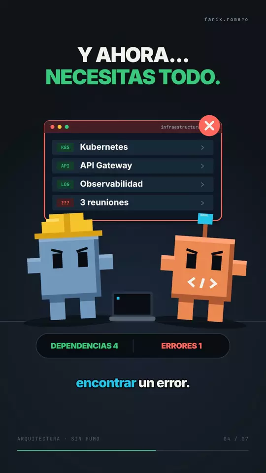

# Un libro. Treinta microservicios.

Narración local con Chatterbox Multilingual V3 y el perfil `mi-voz`. Video vertical
1080×1920, 60 fps, 32,03 segundos; narración a 1,2× conservando el tono.



## Prompt del usuario

«Ya generé la voz, ahora crea lo demás». Después: «Quiero que los videos tengan
este estilo, quiero que la escena sea similar a esto», con una referencia de
personajes de bloques, ventana de código, titulares pesados y subtítulos con
palabra activa cian.

# Guion

Tu compañero se leyó un libro de microservicios y ahora quiere dividir el monolito de la empresa en treinta servicios.
Le preguntas por qué y te responde: «Porque así escala mejor».
Colega, tu aplicación tiene cincuenta usuarios y cuarenta son de recursos humanos.
Ahora necesitas Kubernetes, un API Gateway, observabilidad distribuida y tres reuniones para encontrar un error.
Antes tenías un monolito funcionando. Ahora tienes treinta servicios que no se hablan.
Moraleja: la buena arquitectura no es la que tiene más servicios, sino la que resuelve problemas sin crear otros treinta.

## Proceso y resultado

Se conserva la voz existente como respaldo; la versión actual la acelera a 1,2×
sin cambiar el tono. Se actualizaron palabras, escenas y subtítulos contra esa grabación. Por petición del usuario se eliminó el fondo grave
sostenido: la versión actual contiene voz y efectos puntuales. Las siete escenas y los eventos visuales se anclan a
sus palabras y frases en [Timeline.json](../../projects/001-mi-video/002-Cues/Timeline.json).
Los personajes SVG, la ventana y los contadores persisten a través de los capítulos.
El monolito se divide en treinta nodos como momento principal; el cierre recupera
la claridad del diagrama con «Resuelve problemas».

Se revisaron 50 instantes del video actualizado, incluidos los seis cambios de escena. Se
ampliaron los personajes y se subió la ventana para despejar la infraestructura.
La mezcla se midió en el MP4 final: −14,7 LUFS y pico real −1,9 dBFS.

- [Video final local](../../projects/001-mi-video/004-Render/final.mp4).
- [Preview local](../../projects/001-mi-video/004-Render/preview.mp4).
- [Storyboard y fuentes](../../projects/001-mi-video/003-Escenas/README.md).
- [Revisión visual local](../../projects/001-mi-video/004-Render/review/overview.png).

Los MP4 y WAV se generan localmente y están excluidos de Git.

```bash
npm run project -- render 001-mi-video
```
