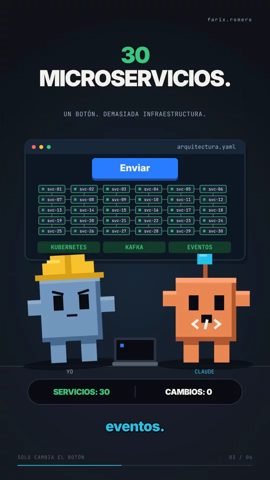

# Solo cambia el botón

Video vertical blocky/pixel-tech, 1080 × 1920, 60 fps, 34,68 segundos.
Diálogo Chatterbox Multilingual V3 a 1,2×: mi-voz para Yo; voz sintética genérica alegre para Claude.



## Encargo

Usar `projects/003-cambia-boton/001-Voz/guion.md` y el estilo de `prompt-escenas-blocky.txt`.
Describir las escenas antes de programarlas. Claude debe tener una voz genérica alegre.
El usuario aprobó el storyboard de seis escenas antes de la implementación.

## Guion original


[Yo] Claude, solo necesito que cambies este botón de azul a verde.

[Claude] ¡Entendido! He rediseñado completamente la arquitectura.

[Yo] ¿Cómo que rediseñado?

[Claude] Ahora tenemos treinta microservicios, Kubernetes, Kafka y una arquitectura orientada a eventos.

[Yo] ¡Pero solo quería cambiar el color de un botón!

[Claude] Lo sé. También implementé escalamiento automático para soportar diez millones de usuarios.

[Yo] ¿Y cuántos usuarios tenemos?

[Claude] Tres. Contándote a ti.

[Yo] ... ¿Y el botón?

[Claude] Sigue azul.

## Proceso

Se preservó el guion original, incluidas sus etiquetas en la misma línea. Se añadió soporte a ese formato
al lector de diálogos y expresividad por hablante. Diez turnos separados, transcripción posterior a la
velocidad definitiva y revisión de palabras de baja confianza con una segunda pasada de Whisper sin contexto.
La transcripción independiente presenta ambigüedades en el nombre Claude y las respuestas de apertura;
la escucha directa del agente no está disponible y queda señalada en el informe.

Las seis escenas y veinte eventos comparten el timeline de la voz. Ventana, personajes y botón persisten;
el botón permanece azul de principio a fin. El plano de seis módulos se despliega en treinta microservicios.
El contador muestra capacidad para diez millones; tres avatares representan los usuarios reales.
El remate acerca el botón original y conserva un cierre de 2,5 segundos después de la grabación.
Subtítulos karaoke, marca farix.romero permanente y efectos puntuales sin música ni fondo sostenido.

La primera revisión detectó módulos pequeños y superpuestos en el plano previo; se ampliaron y separaron.
La segunda revisión cubrió 77 instantes, incluyendo todas las escenas, sus transiciones y el frame cero.
La entrega final se revisó en otros 77 instantes del MP4 definitivo. Audio final: −14,0 LUFS y pico real −2,0 dBFS.

- [Video final local](../../projects/003-cambia-boton/004-Render/final.mp4).
- [Preview local](../../projects/003-cambia-boton/004-Render/preview.mp4).
- [Storyboard](../../projects/003-cambia-boton/003-Escenas/storyboard.md).
- [Informe local](../../projects/003-cambia-boton/004-Render/review/report.json).

Los WAV y MP4 generados permanecen fuera de Git.

```bash
npm run project -- render 003-cambia-boton
```
